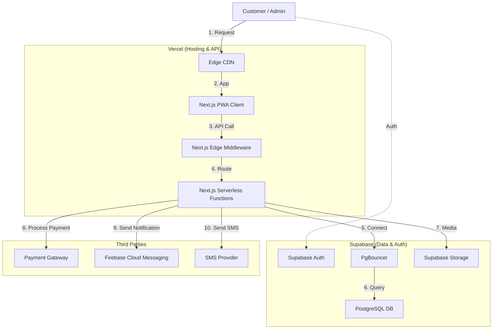

# Complete Infrastructure Design Document – Frisch nach Hause ("Fresh to Home")

- **Document Version:** 2.0
- **Target File:** `/docs/infrastructure_design_document.md`
- **Date:** October 2026
- **Author:** Jasim Ihsan

---

## 1. Infrastructure Stack & Justification

While the preferred stack was Firebase/Google Cloud, we propose the following modern, serverless stack centered around Next.js, Vercel, and Supabase. These changes provide a more robust relational data model and a tighter integration with the frontend framework, while maintaining the serverless benefits.

| Concern | Preferred Service | Proposed Service | Justification |
| :--- | :--- | :--- | :--- |
| PWA hosting | Firebase Hosting | **Vercel** | First-class Next.js support, global edge network, seamless CI/CD integration. |
| Authentication | Firebase Auth | **Supabase Auth (GoTrue)** | Deep integration with PostgreSQL Row Level Security (RLS) for granular data access control. |
| Database | Cloud Firestore | **Supabase (PostgreSQL)** | Relational data model is better suited for e-commerce (ACID transactions, complex joins for orders/products). |
| API / logic | Cloud Run / Functions | **Next.js Serverless & Edge API / Supabase RPC** | Colocates backend logic with frontend code; Supabase RPC handles ACID transactions safely at the database level. |
| File storage | Cloud Storage | **Supabase Storage** | Simplifies architecture by keeping DB, Auth, and Storage in one ecosystem. |
| Notifications | FCM | **FCM (Firebase Cloud Messaging)** | Remains the industry standard for reliable cross-platform web push notifications. |
| Secrets | Google Secret Manager | **Vercel Environment Variables** | Natively injected into the Next.js build and runtime environments securely. |
| Monitoring | Cloud Logging/Monitoring | **Vercel Analytics & Supabase Observability** | Out-of-the-box performance metrics for Next.js and detailed query performance logs for PostgreSQL. |

### 1.1 Core Reasons for Choosing This Stack

If challenged on why we are not strictly using Firebase connected to Google Cloud SQL (even if premium GCP tiers are already available), the decision comes down to data integrity and engineering velocity:

1. **E-commerce is Inherently Relational:** An e-commerce system is made up of deeply relational data (`Users` -> `Orders` -> `Line Items` -> `Products`). Supabase (PostgreSQL) handles this natively with standard foreign keys, complex joins, and strict ACID transactions (e.g., deducting stock only when payment succeeds). Doing this in a NoSQL database like Firestore requires massive data duplication or complex manual transaction logic.
2. **Preventing a "Frankenstein" Architecture:** If we were to use Firebase Auth/Hosting but swap Firestore for Google Cloud SQL to get relational data, we would lose Firebase's biggest benefit: direct client-to-database querying. We would be forced to manually build, deploy, and maintain a custom API layer for every single database read/write. Supabase gives us the exact same unified, direct-client Developer Experience (DX) as Firebase, but natively built around PostgreSQL.
3. **Native Real-Time Features:** E-commerce platforms benefit heavily from real-time features (e.g., live inventory countdowns). Google Cloud SQL does not natively support real-time listeners for the frontend. Supabase provides real-time websockets natively on top of PostgreSQL without any extra engineering effort.
4. **Next.js Ecosystem Optimization:** Because the frontend is built in Next.js, hosting it on Vercel is vastly superior. Vercel provides automatic Edge CDN caching, image optimization, and zero-config middleware out of the box. Replicating this on Firebase Hosting or Cloud Run requires significant manual DevOps work.
5. **Zero Vendor Lock-in for Data:** PostgreSQL is standard SQL. If the platform scales massively, the entire database can be migrated to AWS RDS, Google Cloud SQL, or bare metal. Building entirely on Firestore locks the data into Google's proprietary NoSQL ecosystem.

---

## 2. Architecture Requirements

### 2.1 Architecture Diagram

The architecture relies on a decoupled structure where the Next.js API acts as a secure proxy and validation layer between the public internet and the database.

### 2.2 API Logic Distribution (Compute Allocation)

Instead of Cloud Run vs Cloud Functions, our compute logic is divided between **Next.js Serverless Functions** and **Supabase RPCs (Stored Procedures)**:
- **Next.js Serverless Functions (Vercel):** Handles most API logic (`/api/v1/*`), integrations with third parties (Stripe for payments, FCM for notifications), and input validation (Zod). They are ephemeral, scale instantly, and act as the core API layer.
- **Supabase RPCs (PostgreSQL):** Handles logic that requires strict ACID guarantees and prevents race conditions, such as the checkout process. For example, verifying stock, decrementing inventory, and creating the order are executed as a single atomic transaction inside the database via RPC.

### 2.3 Environments

We utilize three distinct environments: **Development**, **Staging**, and **Production**.
- **Separate Projects:** Each environment maps to a separate Supabase project (e.g., `ftm-dev`, `ftm-staging`, `ftm-prod`) to ensure complete data isolation.
- **Vercel Environments:** Vercel handles deployments for each branch. `main` deploys to Production, while PRs and other branches generate Preview deployments linked to the Staging/Dev Supabase projects.
- **Config & Secrets:** Environment variables (e.g., `NEXT_PUBLIC_SUPABASE_URL`, `SUPABASE_SERVICE_ROLE_KEY`, `STRIPE_SECRET_KEY`) are managed in Vercel's environment variables settings, scoped specifically to `Development`, `Preview`, and `Production` environments.

### 2.4 CI/CD Pipeline

We utilize **GitHub Actions** in combination with **Vercel's built-in CI/CD**:
1. **Push to Branch / PR Creation:**
   - **Lint & Test:** GitHub Actions run ESLint, Prettier, and unit tests.
   - **Database Migrations:** GitHub Actions validate Supabase local migrations against the staging database using the Supabase CLI.
   - **Preview Deployment:** Vercel automatically builds and deploys a preview URL.
2. **Merge to `main` (Production):**
   - **Database Deploy:** GitHub Actions apply the Supabase migrations to the production database project.
   - **Build & Deploy:** Vercel builds the Next.js production bundle and deploys it to the edge network globally.

### 2.5 Security

- **IAM & Least Privilege:** Vercel acts as a client to Supabase. Database interactions from the frontend use the authenticated user's JWT, leveraging PostgreSQL **Row Level Security (RLS)** to ensure users only access their own data. The powerful `Service Role Key` is strictly limited to backend Vercel Serverless Functions and never exposed to the client.
- **Data Protection:** Supabase Storage buckets enforce policies allowing public reads for product images but restricting uploads/deletes to authenticated admins.
- **CORS & HTTPS:** Vercel strictly enforces HTTPS for all traffic. CORS is configured to only allow requests from the designated frontend domains.
- **Bot Protection:** Vercel's Edge Middleware provides rate limiting and basic bot protection (analogous to App Check), intercepting unauthorized traffic before it hits the API routes or database.

### 2.6 Scaling and Cost

- **Expected Load:** The platform will initially serve a small user base of **10 to 50 users**. There are no flash sales or massive traffic spikes expected, just standard e-commerce features.
- **Vercel (Proposed) vs Firebase Hosting/Cloud Run (Preferred):** For this low traffic, we can safely use the **Vercel Hobby Tier ($0/month)**. While Firebase Hosting and Cloud Run also offer generous free tiers, Vercel provides a superior Developer Experience (DX) for Next.js and zero-configuration serverless deployments at the exact same price point.
- **Supabase (Proposed) vs Firestore (Preferred):** We can utilize the **Supabase Free Tier ($0/month)**, which includes 500MB database space, 2GB bandwidth, and 50,000 monthly active users—vastly exceeding our 10-50 user requirement. While Firestore's free tier is also robust, Supabase gives us the power of a fully relational PostgreSQL database (ACID transactions, complex joins) rather than NoSQL, preventing data inconsistency without any added cost.
- **Rough Monthly Cost:** **$0/month** on the Free Tiers for both Vercel and Supabase. The core benefit of this proposed stack is gaining an enterprise-grade relational database (PostgreSQL) and the optimal Next.js hosting environment (Vercel) completely free for the initial launch. Replicating this relational robustness on standard Google Cloud SQL would otherwise incur significant fixed monthly costs.

### 2.7 Backup and Recovery

- **Scheduled Backups:** The Supabase Pro tier includes automated daily backups and **Point-in-Time Recovery (PITR)** with up to 7 days of retention.
- **Restore Approach:** In the event of catastrophic data corruption, the database can be restored to any specific minute within the PITR window via the Supabase Dashboard, minimizing data loss to mere minutes.
