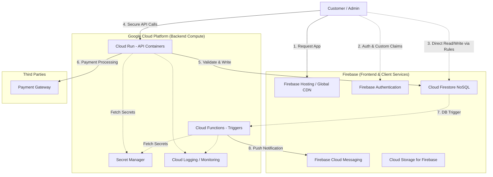

# Infrastructure Design Document (Preferred Stack) – Frisch nach Hause ("Fresh to Home")

- **Document Version:** 1.0
- **Target File:** `/docs/preferred_infrastructure_design.md`
- **Date:** October 2026
- **Author:** Jasim Ihsan

---

## 1. Overview

This document outlines the infrastructure architecture for the "Fresh to Home" platform strictly utilizing the **preferred Firebase and Google Cloud ecosystem**. This stack provides a highly scalable, serverless architecture that deeply integrates frontend delivery, NoSQL data storage, and containerized backend compute without needing to manage underlying servers.

### Why Use the Preferred Stack?

- **Unified Ecosystem:** Google Cloud and Firebase offer deep, seamless integration. Authentication, Database, Storage, and Hosting all work together out of the box with centralized IAM.
- **Real-time Capabilities:** Cloud Firestore inherently supports real-time data synchronization, making it incredibly easy to update order statuses or inventory counts live on the client side.
- **Generous Free Tiers:** Firebase and GCP offer exceptional free tiers for early-stage applications, allowing the platform to serve initial users essentially for free.
- **Serverless Simplicity:** Cloud Run and Cloud Functions automatically scale from zero to handle massive spikes in traffic without manual server intervention.

---

## 2. Core Infrastructure Components

- **PWA Hosting:** **Firebase Hosting** serves the frontend PWA, backed by a global CDN for low-latency asset delivery.
- **Authentication:** **Firebase Authentication** manages user sign-ups (Email/Phone OTP). Admin roles are securely handled via Custom Claims assigned to admin users.
- **Database:** **Cloud Firestore** serves as the primary NoSQL document database, allowing for flexible schemas and real-time listeners.
- **API / Logic:** **Cloud Run** hosts the containerized core REST API, while **Cloud Functions for Firebase** handle asynchronous background tasks and database triggers.
- **File Storage:** **Cloud Storage for Firebase** securely stores product images and media.
- **Notifications:** **Firebase Cloud Messaging (FCM)** handles web push notifications for order updates.
- **Secrets:** **Google Secret Manager** securely stores API keys (e.g., Stripe) and injects them into Cloud Run and Cloud Functions at runtime.
- **Monitoring:** **Cloud Logging, Cloud Monitoring, and Crashlytics** provide a unified dashboard for tracing errors and analyzing performance.

---

## 3. High-Level Architecture Diagram

---

## 4. Compute Logic Allocation (Cloud Run vs Cloud Functions)

Compute responsibilities are strategically split to optimize for response times and background processing:

- **Cloud Run (Containerized API):**
   - **What lives here:** The core REST API (e.g., Express.js or NestJS), complex business logic, third-party payment integrations (Stripe checkout), and order placement validation.
   - **Why:** Cloud Run handles concurrent requests efficiently within a single container instance, making it highly performant for synchronous, user-facing API calls that require fast response times.
- **Cloud Functions for Firebase (Triggers):**
   - **What lives here:** Event-driven asynchronous logic, such as Firestore triggers (`onCreate`, `onUpdate`). Examples include sending an FCM push notification when an order status changes to "OUT_FOR_DELIVERY", or resizing a newly uploaded product image.
   - **Why:** Functions are perfect for background tasks that don't need to block the user's immediate HTTP request.

---

## 5. Environments

We isolate configurations by using completely separate GCP/Firebase projects:

- **Projects:** Three isolated projects: `ftm-dev`, `ftm-staging`, and `ftm-prod`.
- **Isolation:** Each project has its own distinct Firestore database, Auth instance, and Cloud Run endpoints, ensuring experimental code in dev never touches production data.
- **Secrets & Config:** Secrets (like `STRIPE_SECRET_KEY`) are stored in Google Secret Manager independently for each project. Firebase environment variables are used to point the frontend to the correct backend based on the deployment target.

---

## 6. CI/CD Pipeline

We utilize **GitHub Actions** for an automated pipeline to ensure code quality and seamless deployments:

1. **Pull Request (CI):**
   - Linting, unit tests, and type checking are executed.
   - Firebase Hosting generates a temporary Preview Channel URL for visual review.
2. **Merge to Main (CD):**
   - **Frontend:** GitHub Actions deploy the production bundle to Firebase Hosting.
   - **Backend API:** Docker images are built and pushed to Google Artifact Registry, then deployed to Cloud Run.
   - **Triggers:** Cloud Functions are deployed via the Firebase CLI.
   - **Security & Schema:** Firestore Security Rules and composite database indexes are deployed to ensure strict access control.

---

## 7. Security Architecture

- **Least Privilege (IAM):** Cloud Run and Cloud Functions run under dedicated Service Accounts with minimal IAM permissions—only granting access to exactly the GCP services they need (e.g., Firestore and Secret Manager).
- **Firestore Security Rules:** The client directly accesses Firestore for reads, but access is strictly gated by Security Rules. For example, users can only read their own `orders` documents, and only users with an `admin` Custom Claim on their Auth token can write to the `products` collection.
- **App Check:** Firebase App Check (using reCAPTCHA Enterprise) is enforced to ensure that calls to Firebase services (Firestore, Storage, Functions) strictly originate from our authentic PWA, dropping bot and replay traffic.
- **CORS & HTTPS:** Cloud Run endpoints are restricted via CORS to only accept requests from our Firebase Hosting domains. All traffic is enforced over HTTPS.

---

## 8. Scaling and Cost

- **Expected Load:** Initially 10 to 50 active users, scaling gracefully over time.
- **Cost Efficiency:**
   - **Firebase Free Tier (Spark/Blaze):** The platform can comfortably sit within the generous free tiers. Authentication (50k MAU), Firestore (50k reads/20k writes per day), and Cloud Storage all offer massive free allowances.
   - **Cloud Run / Functions:** Offers millions of free invocations per month.
- **Scaling:** Cloud Run and Cloud Functions automatically scale instances from zero up to a defined maximum to handle sudden spikes (e.g., marketing pushes), and back down to zero to save costs during idle periods.
- **Rough Monthly Cost:** **$0/month** for the initial 10-50 users. As traffic scales to thousands of users, the Serverless pay-as-you-go model ensures costs remain strictly proportional to actual usage, avoiding the flat costs of idle provisioned servers.

---

## 9. Backup and Recovery

- **Scheduled Exports:** We will utilize Google Cloud Scheduler and a Cloud Function to trigger automated daily exports of the Firestore database to a dedicated Cloud Storage bucket.
- **Recovery:** In the event of data corruption, we can use the `gcloud firestore import` command to restore collections from these Cloud Storage backups, returning the system to a known healthy state.
