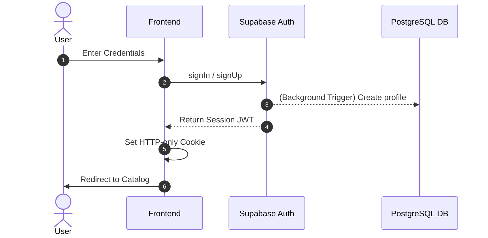
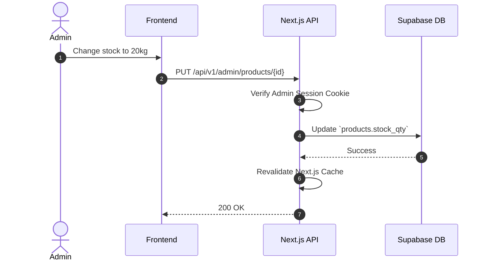
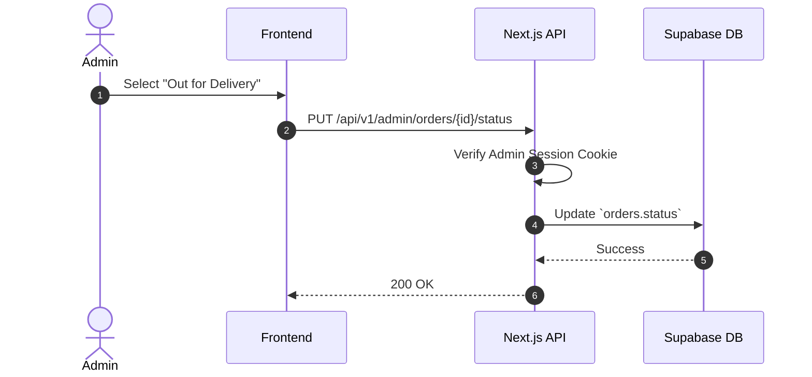

# Technical Design Document (TDD) – Frisch nach Hause ("Fresh to Home")

- **Document Version:** 1.0
- **Target File:** `/docs/technical-design.md`
- **Date:** October 2026
- **Author:** Jasim Ihsan

---

## 1. Scope and Assumptions

### 1.1 Scope (v1)

**In Scope:**

- **PWA Capabilities:** Web app manifest, service worker for offline fallback, and installability on Android/iOS (with manual instructions for iOS).
- **Authentication:** Customer registration, login, and session management via Supabase Auth.
- **Catalog & Cart:** Browsing products with real-time stock, managing a database-backed cart with quantities in 0.5 kg increments.
- **Checkout Flow:** Capturing delivery address, atomic stock decrement to prevent overselling, and persisting the order.
- **Admin Functionality:** Back-office capabilities to add/edit products, toggle availability, adjust stock, view customer orders, and update order statuses (Placed -> Out for Delivery -> Delivered).
- **Legal:** Static GDPR-compliant privacy policy with mandatory consent on sign-up.

**Out of Scope (v1):**

- **Live Payments:** Real payment gateway integration (Stripe, PayPal). Orders will be placed as "Cash on Delivery" or offline invoice.
- **Notifications:** Push notifications and automated emails are deferred.
- **Localization:** Multi-language support (app remains German-only).

### 1.2 Business Logic Assumptions

Because the Business Requirements Document (BRD) leaves some edge cases open, we made the following assumptions for v1:

1. **Tech Stack Override:** The assignment brief mentions Firebase, but the BRD explicitly specs Supabase. Per our clarification, this implementation proceeds with Next.js and Supabase (PostgreSQL).
2. **Out-of-Stock Visibility:** Products with `stock_qty = 0` will remain visible in the customer catalog with an "Ausverkauft" (Sold Out) state to aid product discovery, unless an admin explicitly sets `is_available = false`.
3. **RBAC Provisioning:** The first Admin account will be provisioned by manually updating their user profile record in the database. No UI is built in v1 for creating new admin users.
4. **Order Status Lifecycle:** Orders are created with a default status of `PLACED`. We assume the full lifecycle includes `PLACED`, `OUT_FOR_DELIVERY`, and `DELIVERED`.
5. **Order Cancellation & Restocking:** Customers can cancel their own orders as long as the status is still `PLACED`. We assume canceling an order must automatically restock the items (need clarification from the client on order cancellation).

### 1.3 Architectural Decisions

The following features are not strictly defined in the MVP BRD but have been architecturally included to ensure a robust, production-ready foundation:

1. **Thick Database Architecture:** We made an explicit decision to rely on PostgreSQL for data integrity. Row Level Security (RLS) handles authorization, and Supabase RPCs (Stored Procedures) handle transactions (e.g., atomic checkout). This simplifies the Next.js API and mathematically prevents race conditions like overselling.
2. **Multiple Delivery Addresses:** Rather than a simple text field on the user profile, we created a normalized `user_addresses` table. This drastically improves UX by allowing customers to save multiple addresses and set a `is_primary` flag (enforced by a database unique index).
3. **Product Categorization:** To support future scalability (e.g., Beef, Poultry, Fish), we introduced a `categories` table. Adding this relation from day one prevents a messy data migration later and drastically improves the customer browsing experience.

---

## 2. User Roles and Permissions

The system leverages Supabase Auth and PostgreSQL Row Level Security (RLS) to enforce Role-Based Access Control securely at the database level. Roles are stored in a `profiles` table linked to the `auth.users` table.

| Permission / Action              | Guest | Customer | Admin | Enforcement Mechanism                                  |
| :------------------------------- | :---: | :------: | :---: | :----------------------------------------------------- |
| View Home & Install Instructions |  Yes  |   Yes    |  Yes  | Public Next.js Route                                   |
| View Product Catalog & Prices    |  Yes  |   Yes    |  Yes  | RLS on `products` table (`is_available = true`)        |
| Add Items to Cart / Manage Cart  |  No   |   Yes    |  Yes  | RLS on `cart_items` table (`customer_id = auth.uid()`) |
| Place Order & Decrement Stock    |  No   |   Yes    |  Yes  | Next.js API Route (executing Supabase RPC transaction) |
| View Personal Order History      |  No   |   Yes    |  Yes  | RLS (`customer_id = auth.uid()`)                       |
| Update Personal Profile          |  No   |   Yes    |  Yes  | RLS (`id = auth.uid()`)                                |
| Manage Delivery Addresses        |  No   |   Yes    |  Yes  | RLS on `user_addresses` (`customer_id = auth.uid()`)   |
| Create / Edit Categories         |  No   |    No    |  Yes  | Next.js API Route + RLS (`role = 'admin'`)             |
| Create / Edit Products           |  No   |    No    |  Yes  | Next.js API Route + RLS (`role = 'admin'`)             |
| Adjust Stock & Availability      |  No   |    No    |  Yes  | Next.js API Route + RLS (`role = 'admin'`)             |
| View All Customer Orders         |  No   |    No    |  Yes  | RLS (`role = 'admin'`)                                 |
| Update Order Status              |  No   |    No    |  Yes  | Next.js API Route + RLS (`role = 'admin'`)             |

---

## 3. Functional Modules

1. **Authentication Module:** Securely manages user registration, login, and session persistence using Supabase Auth. It captures GDPR consent on sign-up, sets HTTP-only cookies via Next.js middleware, and uses PostgreSQL triggers to auto-provision user profiles.
2. **Product Module:** Powers the customer-facing catalog, allowing users to browse, search, and view categories of fresh meat. It reads directly from Supabase to ensure stock availability is displayed in real-time, safely filtered by RLS policies.
3. **User Module (Address & Cart):** Manages the customer's personal data and pre-checkout experience. It handles a database-backed cart (syncing items and 0.5kg quantities across devices) and maintains the user's address book for quick primary delivery selection.
4. **Order Module:** The core transactional engine that safely converts a cart into a finalized order. It executes an atomic PostgreSQL transaction (via Supabase RPC) to decrement stock and create order records simultaneously, completely preventing overselling. It also handles order history and cancellations.
5. **Admin Module:** A role-protected back-office suite that gives shop owners full CRUD control over product inventory and categories. It also provides an order management board to progress customer orders through fulfillment (Placed -> Out for Delivery -> Delivered).

---

## 4. Data Model (Supabase / PostgreSQL)

The database utilizes PostgreSQL via Supabase. We heavily rely on relational constraints and Row Level Security (RLS) to maintain data integrity.

### 4.1 `profiles` Table

- **Purpose:** Extends the built-in Supabase `auth.users` table with application-specific data.
- **Key Fields:**
   - `id` (uuid, PK, references `auth.users(id)`)
   - `name` (text)
   - `email` (text)
   - `role` (enum: `'customer'`, `'admin'`) - defaults to `'customer'`
   - `created_at` (timestamp)
- **RLS Policies:** Users can read/update their own profile. Admins can read all profiles.

### 4.2 `user_addresses` Table

- **Purpose:** Stores one or multiple delivery addresses for a customer, identifying which is their primary choice.
- **Key Fields:**
   - `id` (uuid, PK)
   - `customer_id` (uuid, FK to `profiles(id)`)
   - `address_line_1` (text)
   - `city` (text)
   - `postal_code` (text)
   - `is_primary` (boolean) - defaults to `false`
   - `created_at` (timestamp)
- **Database Constraints:** Enforces a Unique Partial Index on `(customer_id) WHERE is_primary = true` to guarantee a user can never have more than one primary address.
- **RLS Policies:** Customers can read, insert, update, and delete their own addresses (`customer_id = auth.uid()`).

### 4.3 `categories` Table

- **Purpose:** Organizes products into logical groupings (e.g., Beef, Poultry, Specials) for better browsing UX.
- **Key Fields:**
   - `id` (uuid, PK)
   - `name` (text)
   - `slug` (text) - URL-friendly identifier
   - `sort_order` (numeric)
   - `deleted_at` (timestamp) - Nullable, used for soft deletes
- **RLS Policies:** Anyone (public) can read where `deleted_at IS NULL`. Admins can insert, update, and soft delete.

### 4.4 `products` Table

- **Purpose:** The global catalog of products and current stock.
- **Key Fields:**
   - `id` (uuid, PK)
   - `category_id` (uuid, FK to `categories(id)`)
   - `name` (text)
   - `description` (text)
   - `price_per_kg` (numeric)
   - `image_url` (text)
   - `stock_qty` (numeric) - precision suitable for 0.5kg increments
   - `is_available` (boolean)
   - `updated_at` (timestamp)
   - `deleted_at` (timestamp) - Nullable, used for soft deletes
- **Indexes:** `idx_products_is_available` on `(is_available)` to speed up customer catalog loading.
- **RLS Policies:** Anyone (public) can read where `is_available = true AND deleted_at IS NULL`. Admins can read all, insert, update, and soft delete.

### 4.5 `cart_items` Table

- **Purpose:** Persists the active cart state for a customer across devices.
- **Key Fields:**
   - `id` (uuid, PK)
   - `customer_id` (uuid, FK to `profiles(id)`)
   - `product_id` (uuid, FK to `products(id)`)
   - `quantity_kg` (numeric)
   - `updated_at` (timestamp)
- **Indexes:** `idx_cart_items_customer_id` on `(customer_id)` for fast cart retrieval.
- **RLS Policies:** Customers can read, insert, update, and delete their own cart items (`customer_id = auth.uid()`).

### 4.6 `orders` Table

- **Purpose:** Represents a completed checkout (the parent record).
- **Key Fields:**
   - `id` (uuid, PK)
   - `customer_id` (uuid, FK to `profiles(id)`)
   - `delivery_address_id` (uuid, FK to `user_addresses(id)`)
   - `total_amount` (numeric)
   - `status` (text) - enum: `'PLACED'`, `'OUT_FOR_DELIVERY'`, `'DELIVERED'`, `'CANCELLED'`
   - `created_at` (timestamp)
- **Indexes:** `idx_orders_customer_id` on `(customer_id)`, and `idx_orders_created_at` on `(created_at)` to optimize admin dashboard sorting and customer history queries.
- **RLS Policies:** Customers can read their own orders. Admins can read all. (Insertions are handled via elevated privileges in the checkout RPC).

### 4.7 `order_items` Table

- **Purpose:** Line items for each order.
- **Key Fields:**
   - `id` (uuid, PK)
   - `order_id` (uuid, FK to `orders(id)`)
   - `product_id` (uuid, FK to `products(id)`)
   - `quantity_kg` (numeric)
   - `unit_price` (numeric) - snapshot of price at time of order
   - `line_total` (numeric) - pre-calculated total cost for that specific row
- **Indexes:** `idx_order_items_order_id` on `(order_id)` to fast-fetch items when viewing an order detail page.
- **RLS Policies:** Customers can read items linked to their own orders. Admins can read all.

### 4.8 `order_status_history` Table

- **Purpose:** Tracks the lifecycle of an order over time (Event Sourcing) instead of just mutating a single status field. This allows auditing exactly when an order transitioned between states.
- **Key Fields:**
   - `id` (uuid, PK)
   - `order_id` (uuid, FK to `orders(id)`)
   - `status` (text) - enum: `'PLACED'`, `'OUT_FOR_DELIVERY'`, `'DELIVERED'`, `'CANCELLED'`
   - `created_at` (timestamp) - The exact time the status changed
- **Indexes:** `idx_order_status_history_order_id` on `(order_id)`.
- **RLS Policies:** Customers can read history for their own orders. Admins can read all. A database trigger automatically inserts a record here whenever `orders.status` is updated.

---

## 5. API Endpoints vs. Direct Client Access

### 5.1 Architecture Strategy

- **Next.js API Routes:** To provide a clean, documented, and easily testable contract between the frontend and backend, all data mutations and complex queries are routed through a RESTful API hosted on Next.js Server.
- **Direct Supabase Access:** Some highly cacheable read operations (like fetching the public catalog) may bypass the Next.js API for performance, hitting Supabase directly. However, the complete API surface is documented below for completeness.

### 5.2 Next.js API Endpoints (Complete Surface)

> **Interactive API Documentation:** A complete, interactive Swagger UI documentation for these **27 core API endpoints** can be found here: [Fresh To Home API Swagger Docs](https://app.swaggerhub.com/apis-docs/self-8de/Fresh-To-Home-API-Doc/1.0?view=uiDocs#/).

The tables below provide a technical overview of these core API endpoints, which dictate the boundaries between the Next.js client and server.

#### Authentication Endpoints

| Field             | What to specify                                                                                                                                                     |
| :---------------- | :------------------------------------------------------------------------------------------------------------------------------------------------------------------ |
| **Method + path** | `POST /api/v1/auth/register`                                                                                                                                        |
| **Purpose**       | Registers a new customer account.                                                                                                                                   |
| **Auth**          | Public                                                                                                                                                              |
| **Request**       | JSON body: `{ "email": "string", "password": "string", "name": "string", "gdprConsent": boolean }`                                                                  |
| **Response**      | `201 Created` - JSON: `{ "user": { "id": "uuid", "email": "string" } }`                                                                                             |
| **Errors**        | `400` (Validation/Consent missing), `409` (Email exists).                                                                                                           |
| **Notes**         | Calls Supabase to create the user. Sets a secure HTTP-only session cookie on the Next.js server. A Postgres trigger automatically provisions the `profiles` record. |

 

| Field             | What to specify                                                                                                                 |
| :---------------- | :------------------------------------------------------------------------------------------------------------------------------ |
| **Method + path** | `POST /api/v1/auth/login`                                                                                                       |
| **Purpose**       | Authenticates a user (Customer or Admin) and establishes a session.                                                             |
| **Auth**          | Public                                                                                                                          |
| **Request**       | JSON body: `{ "email": "string", "password": "string" }`                                                                        |
| **Response**      | `200 OK` - JSON: `{ "user": { "id": "uuid", "role": "string" } }`                                                               |
| **Errors**        | `400` (Validation), `401` (Invalid credentials).                                                                                |
| **Notes**         | Uses Supabase Auth to verify credentials. Sets a secure HTTP-only cookie on the Next.js server for all subsequent API requests. |

 

| Field             | What to specify                                                       |
| :---------------- | :-------------------------------------------------------------------- |
| **Method + path** | `POST /api/v1/auth/logout`                                            |
| **Purpose**       | Terminates the active session.                                        |
| **Auth**          | Customer/Admin                                                        |
| **Request**       | None                                                                  |
| **Response**      | `200 OK` - JSON: `{ "success": true }`                                |
| **Errors**        | None                                                                  |
| **Notes**         | Clears the HTTP-only session cookie and signs out from Supabase Auth. |

#### Profile & Identity Endpoints

| Field             | What to specify                                |
| :---------------- | :--------------------------------------------- |
| **Method + path** | `GET /api/v1/profile`                          |
| **Purpose**       | Fetches the authenticated user's profile data. |
| **Auth**          | Customer/Admin; Session cookie verified.       |
| **Request**       | None                                           |
| **Response**      | `200 OK` - JSON profile object.                |
| **Errors**        | `401` (Unauthorized)                           |
| **Notes**         | Returns data from the `profiles` table.        |

 

| Field             | What to specify                                               |
| :---------------- | :------------------------------------------------------------ |
| **Method + path** | `PUT /api/v1/profile`                                         |
| **Purpose**       | Updates the authenticated user's profile details (e.g. Name). |
| **Auth**          | Customer/Admin; Session cookie verified.                      |
| **Request**       | JSON body: `{ "name": "string" }`                             |
| **Response**      | `200 OK` - JSON profile object.                               |
| **Errors**        | `400` (Validation error), `401` (Unauthorized).               |
| **Notes**         | Updates the `profiles` table.                                 |

#### Address Management Endpoints

| Field             | What to specify                              |
| :---------------- | :------------------------------------------- |
| **Method + path** | `GET /api/v1/addresses`                      |
| **Purpose**       | Fetches the user's saved delivery addresses. |
| **Auth**          | Customer; Session cookie verified.           |
| **Request**       | None                                         |
| **Response**      | `200 OK` - JSON array of address objects.    |
| **Errors**        | `401` (Unauthorized)                         |
| **Notes**         | Returns data from `user_addresses`.          |

 

| Field             | What to specify                                                                                                           |
| :---------------- | :------------------------------------------------------------------------------------------------------------------------ |
| **Method + path** | `POST /api/v1/addresses`                                                                                                  |
| **Purpose**       | Adds a new delivery address for the user.                                                                                 |
| **Auth**          | Customer; Session cookie verified.                                                                                        |
| **Request**       | JSON body: `{ "addressLine1": "string", "city": "string", "postalCode": "string", "isPrimary": boolean }`                 |
| **Response**      | `201 Created` - JSON address object.                                                                                      |
| **Errors**        | `400` (Validation error), `401` (Unauthorized).                                                                           |
| **Notes**         | If `isPrimary` is true, a trigger automatically toggles false on all other addresses to satisfy the unique partial index. |

 

| Field             | What to specify                                                              |
| :---------------- | :--------------------------------------------------------------------------- |
| **Method + path** | `PUT /api/v1/addresses/{addressId}`                                          |
| **Purpose**       | Updates an existing delivery address.                                        |
| **Auth**          | Customer; Session cookie verified.                                           |
| **Request**       | Path param: `addressId`. JSON body (Partial).                                |
| **Response**      | `200 OK` - JSON address object.                                              |
| **Errors**        | `400` (Validation error), `401` (Unauthorized), `404` (Not Found/Not Owned). |
| **Notes**         | Updates data in `user_addresses`.                                            |

 

| Field             | What to specify                                         |
| :---------------- | :------------------------------------------------------ |
| **Method + path** | `DELETE /api/v1/addresses/{addressId}`                  |
| **Purpose**       | Deletes an address from the user's account.             |
| **Auth**          | Customer; Session cookie verified.                      |
| **Request**       | Path param: `addressId`.                                |
| **Response**      | `200 OK` - JSON `{ "success": true }`.                  |
| **Errors**        | `401` (Unauthorized), `404` (Not Found).                |
| **Notes**         | Checks if the address is tied to an active order first. |

#### Catalog Endpoints (Public)

| Field             | What to specify                            |
| :---------------- | :----------------------------------------- |
| **Method + path** | `GET /api/v1/categories`                   |
| **Purpose**       | Fetches all active product categories.     |
| **Auth**          | Public                                     |
| **Request**       | None                                       |
| **Response**      | `200 OK` - JSON array of category objects. |
| **Errors**        | `500` (Server Error)                       |
| **Notes**         | Highly cacheable (ISR).                    |

 

| Field             | What to specify                                                                                                                                                          |
| :---------------- | :----------------------------------------------------------------------------------------------------------------------------------------------------------------------- |
| **Method + path** | `GET /api/v1/products`                                                                                                                                                   |
| **Purpose**       | Fetches the active product catalog, optionally filtered, searched, and paginated.                                                                                        |
| **Auth**          | Public                                                                                                                                                                   |
| **Request**       | Query params: `?categoryId={uuid}&q={string}&page={number}&limit={number}` (optional)                                                                                    |
| **Response**      | `200 OK` - JSON object containing `data` (array of product objects) and `pagination` (metadata).                                                                         |
| **Errors**        | `500` (Server Error)                                                                                                                                                     |
| **Notes**         | Returns only `is_available = true AND deleted_at IS NULL`. Uses `LIMIT` and `OFFSET` for pagination. Real-time stock requires aggressive cache-busting on admin updates. |

 

| Field             | What to specify                                                     |
| :---------------- | :------------------------------------------------------------------ |
| **Method + path** | `GET /api/v1/products/{productId}`                                  |
| **Purpose**       | Fetches dynamic details for a single product (Product Detail Page). |
| **Auth**          | Public                                                              |
| **Request**       | Path param: `productId` (uuid).                                     |
| **Response**      | `200 OK` - JSON product object.                                     |
| **Errors**        | `404` (Not Found / Unavailable).                                    |
| **Notes**         | Used for detailed viewing and metadata scraping.                    |

#### Cart Endpoints

| Field             | What to specify                                                  |
| :---------------- | :--------------------------------------------------------------- |
| **Method + path** | `GET /api/v1/cart`                                               |
| **Purpose**       | Fetches the current user's active cart items.                    |
| **Auth**          | Customer; Session cookie verified.                               |
| **Request**       | None                                                             |
| **Response**      | `200 OK` - JSON array of cart items with nested product details. |
| **Errors**        | `401` (Unauthorized)                                             |
| **Notes**         | Reads from `cart_items` joined with `products`.                  |

 

| Field             | What to specify                                                            |
| :---------------- | :------------------------------------------------------------------------- |
| **Method + path** | `POST /api/v1/cart`                                                        |
| **Purpose**       | Adds an item to the cart or updates its quantity.                          |
| **Auth**          | Customer; Session cookie verified.                                         |
| **Request**       | JSON body: `{ "productId": "uuid", "quantityKg": 1.5 }`                    |
| **Response**      | `200 OK` - JSON: `{ "cartItemId": "uuid" }`                                |
| **Errors**        | `400` (Invalid quantity), `401` (Unauthorized), `404` (Product not found). |
| **Notes**         | Upserts the `cart_items` table. Enforces 0.5kg increments.                 |

 

| Field             | What to specify                        |
| :---------------- | :------------------------------------- |
| **Method + path** | `DELETE /api/v1/cart/{itemId}`         |
| **Purpose**       | Removes an item from the cart.         |
| **Auth**          | Customer; Session cookie verified.     |
| **Request**       | Path param: `itemId` (uuid)            |
| **Response**      | `200 OK` - JSON: `{ "success": true }` |
| **Errors**        | `401` (Unauthorized)                   |
| **Notes**         | Idempotent operation.                  |

 

| Field             | What to specify                                                                                                                                              |
| :---------------- | :----------------------------------------------------------------------------------------------------------------------------------------------------------- |
| **Method + path** | `POST /api/v1/cart/verify`                                                                                                                                   |
| **Purpose**       | Verifies cart products are still in stock before proceeding to checkout.                                                                                     |
| **Auth**          | Customer; Session cookie verified.                                                                                                                           |
| **Request**       | None. (Reads current user's cart from DB)                                                                                                                    |
| **Response**      | `200 OK` - JSON: `{ "isValid": boolean, "unavailableItems": [...] }`                                                                                         |
| **Errors**        | `401` (Unauthorized)                                                                                                                                         |
| **Notes**         | Solves the race condition where a user leaves an item in their cart overnight and someone else buys it. Must be called immediately before placing the order. |

#### Order Endpoints (Customer)

| Field             | What to specify                    |
| :---------------- | :--------------------------------- |
| **Method + path** | `GET /api/v1/orders`               |
| **Purpose**       | Fetches the user's order history.  |
| **Auth**          | Customer; Session cookie verified. |
| **Request**       | None                               |
| **Response**      | `200 OK` - JSON array of orders.   |
| **Errors**        | `401` (Unauthorized)               |
| **Notes**         | Sorted by `created_at` descending. |

 

| Field             | What to specify                                                                                                                                                     |
| :---------------- | :------------------------------------------------------------------------------------------------------------------------------------------------------------------ |
| **Method + path** | `POST /api/v1/orders`                                                                                                                                               |
| **Purpose**       | Securely places a new order and atomically decrements inventory stock.                                                                                              |
| **Auth**          | Customer; Session cookie verified.                                                                                                                                  |
| **Request**       | JSON body: `{ "deliveryAddressId": "uuid" }`. _(Note: Server reads items directly from user's `cart_items` table)._                                                 |
| **Response**      | `201 Created` - JSON: `{ "orderId": "uuid", "totalAmount": 45.5, "status": "PLACED" }`                                                                              |
| **Errors**        | `400` (Empty cart), `401` (Unauthorized), `409` (Insufficient stock).                                                                                               |
| **Notes**         | Uses a Supabase RPC to `SELECT ... FOR UPDATE` on products, decrement stock, insert order, insert order_items, and clear cart_items in one atomic ACID transaction. |

 

| Field             | What to specify                                                                            |
| :---------------- | :----------------------------------------------------------------------------------------- |
| **Method + path** | `POST /api/v1/orders/{orderId}/cancel`                                                     |
| **Purpose**       | Cancels a `PLACED` order and triggers atomic restock of items.                             |
| **Auth**          | Customer; Session cookie verified.                                                         |
| **Request**       | Path param: `orderId`                                                                      |
| **Response**      | `200 OK` - JSON: `{ "success": true, "status": "CANCELLED" }`                              |
| **Errors**        | `400` (Order cannot be cancelled), `401` (Unauthorized), `404` (Order not found).          |
| **Notes**         | Only available if order status is `PLACED`. Restocks products atomically via Supabase RPC. |

#### Admin Endpoints

| Field             | What to specify                                                                |
| :---------------- | :----------------------------------------------------------------------------- |
| **Method + path** | `POST /api/v1/admin/categories`                                                |
| **Purpose**       | Creates a new category.                                                        |
| **Auth**          | Admin; Supabase session validated, checked against `profiles.role == 'admin'`. |
| **Request**       | JSON body: `{ "name": "string", "sortOrder": 1 }`                              |
| **Response**      | `201 Created` - JSON: `{ "categoryId": "uuid" }`                               |
| **Errors**        | `400` (Validation failed), `403` (User lacks admin role).                      |
| **Notes**         | Generates a URL-friendly slug based on name.                                   |

 

| Field             | What to specify                                           |
| :---------------- | :-------------------------------------------------------- |
| **Method + path** | `PUT /api/v1/admin/categories/{categoryId}`               |
| **Purpose**       | Updates an existing category.                             |
| **Auth**          | Admin; Supabase session validated.                        |
| **Request**       | Path param: `categoryId`. JSON body (Partial).            |
| **Response**      | `200 OK` - JSON: `{ "success": true }`                    |
| **Errors**        | `400` (Validation failed), `403` (User lacks admin role). |
| **Notes**         | Triggers Next.js cache revalidation.                      |

 

| Field             | What to specify                                                                         |
| :---------------- | :-------------------------------------------------------------------------------------- |
| **Method + path** | `DELETE /api/v1/admin/categories/{categoryId}`                                          |
| **Purpose**       | Soft deletes a category.                                                                |
| **Auth**          | Admin; Supabase session validated.                                                      |
| **Request**       | Path param: `categoryId`.                                                               |
| **Response**      | `200 OK` - JSON: `{ "success": true }`                                                  |
| **Errors**        | `403` (User lacks admin role), `409` (Conflict: Category has active products).          |
| **Notes**         | Sets `deleted_at` timestamp rather than hard deleting to protect referential integrity. |

 

| Field             | What to specify                                                                                                                                                   |
| :---------------- | :---------------------------------------------------------------------------------------------------------------------------------------------------------------- |
| **Method + path** | `POST /api/v1/admin/products`                                                                                                                                     |
| **Purpose**       | Creates a new product in the catalog.                                                                                                                             |
| **Auth**          | Admin; Supabase session validated.                                                                                                                                |
| **Request**       | JSON body: `{ "categoryId": "uuid", "name": "string", "description": "string", "pricePerKg": 12.99, "imageUrl": "string", "stockQty": 5.0, "isAvailable": true }` |
| **Response**      | `201 Created` - JSON: `{ "productId": "uuid" }`                                                                                                                   |
| **Errors**        | `400` (Validation failed), `403` (User lacks admin role).                                                                                                         |
| **Notes**         | Server validates payload. Triggers Next.js cache revalidation for the catalog pages.                                                                              |

 

| Field             | What to specify                                                                                  |
| :---------------- | :----------------------------------------------------------------------------------------------- |
| **Method + path** | `PUT /api/v1/admin/products/{productId}`                                                         |
| **Purpose**       | Updates an existing product (e.g., adjusting stock, changing price, toggling availability).      |
| **Auth**          | Admin; Supabase session validated.                                                               |
| **Request**       | Path param: `productId` (uuid). JSON body (Partial): `{ "stockQty": 15.0, "isAvailable": true }` |
| **Response**      | `200 OK` - JSON: `{ "success": true }`                                                           |
| **Errors**        | `400` (Validation failed), `403` (User lacks admin role), `404` (Product not found).             |
| **Notes**         | Triggers Next.js cache revalidation for the catalog pages upon success.                          |

 

| Field             | What to specify                                                                                                                                     |
| :---------------- | :-------------------------------------------------------------------------------------------------------------------------------------------------- |
| **Method + path** | `DELETE /api/v1/admin/products/{productId}`                                                                                                         |
| **Purpose**       | Soft deletes a product from the database.                                                                                                           |
| **Auth**          | Admin; Supabase session validated.                                                                                                                  |
| **Request**       | Path param: `productId` (uuid).                                                                                                                     |
| **Response**      | `200 OK` - JSON: `{ "success": true }`                                                                                                              |
| **Errors**        | `403` (User lacks admin role).                                                                                                                      |
| **Notes**         | Sets the `deleted_at` timestamp instead of a hard delete. This guarantees that past orders maintain their referential integrity without 409 errors. |

 

| Field             | What to specify                                                                                  |
| :---------------- | :----------------------------------------------------------------------------------------------- |
| **Method + path** | `GET /api/v1/admin/orders`                                                                       |
| **Purpose**       | Fetches all incoming customer orders for fulfillment, paginated.                                 |
| **Auth**          | Admin; Supabase session validated.                                                               |
| **Request**       | Query params: `?status=PLACED&page={number}&limit={number}` (optional)                           |
| **Response**      | `200 OK` - JSON object containing `data` (array of orders) and `pagination` (metadata).          |
| **Errors**        | `403` (User lacks admin role).                                                                   |
| **Notes**         | Used to populate the Admin Dashboard. Relies on `LIMIT` and `OFFSET` for pagination scalability. |

 

| Field             | What to specify                                                                                                |
| :---------------- | :------------------------------------------------------------------------------------------------------------- |
| **Method + path** | `PUT /api/v1/admin/orders/{orderId}/status`                                                                    |
| **Purpose**       | Updates the fulfillment status of an order.                                                                    |
| **Auth**          | Admin; Supabase session validated.                                                                             |
| **Request**       | Path param: `orderId` (uuid). JSON body: `{ "status": "OUT_FOR_DELIVERY" }`                                    |
| **Response**      | `200 OK` - JSON: `{ "success": true, "status": "OUT_FOR_DELIVERY" }`                                           |
| **Errors**        | `400` (Invalid status transition), `403` (User lacks admin role), `404` (Order not found).                     |
| **Notes**         | Used by the admin back-office to process an order through its lifecycle. Could trigger webhooks in the future. |

---

## 6. Key Flows

### 6.1 Sign-up / Login

**Description:** The application relies on Supabase Auth for identity management, but we must sync that identity to our public `profiles` table to manage roles and relationships.

1. The user enters their email and password on the frontend.
2. The frontend calls the Supabase Auth API directly to authenticate.
3. Upon successful creation, a PostgreSQL Database Trigger fires in the background to automatically create a corresponding row in the public `profiles` table with a default `customer` role.
4. The frontend receives the Session JWT and forwards it to a Next.js API route to set a secure, HTTP-only cookie.
5. The user is redirected to the catalog.

### 6.2 Place an Order (Including Atomic Stock Check)

**Description:** This is the most critical transaction in the system. Because multiple users might try to buy the last piece of meat at the same time, we must lock the database rows to prevent overselling.

1. The customer initiates checkout. The frontend first calls `POST /api/v1/cart/verify` to ensure items are still in stock before proceeding (this is purely for UX to warn users early).
2. If stock is valid, the frontend calls `POST /api/v1/orders`.
3. The Next.js API executes an atomic Supabase RPC (Stored Procedure) which serves as the true source of data integrity, protecting against race conditions between the `verify` and `checkout` steps.
4. Inside the RPC, PostgreSQL locks the specific product rows (`SELECT ... FOR UPDATE`).
5. It verifies stock one last time. If stock is insufficient, it rolls back the entire transaction.
6. If stock is sufficient, it decrements the product stock, inserts the order and order items, and empties the cart—all in one guaranteed motion.

```mermaid
sequenceDiagram
    autonumber
    actor Customer
    participant Client as Frontend
    participant API as Next.js API
    participant DB as PostgreSQL (RPC)

    Customer->>Client: Click "Place Order"
    Client->>API: POST /api/v1/cart/verify
    API-->>Client: Stock is Valid
    Client->>API: POST /api/v1/orders
    API->>DB: execute `checkout()`

    rect rgb(30, 30, 30)
        Note right of DB: --- ATOMIC TRANSACTION ---
        DB->>DB: LOCK product rows
        DB->>DB: Re-check stock vs cart qty
        alt Insufficient Stock
            DB-->>API: ROLLBACK! (409 Conflict)
        else Sufficient Stock
            DB->>DB: 1. Decrement product stock
            DB->>DB: 2. Insert into `orders`
            DB->>DB: 3. Insert into `order_items`
            DB->>DB: 4. Clear `cart_items`
        end
    end

    DB-->>API: Transaction Committed
    API-->>Client: 201 Created
    Client-->>Customer: Show Success Screen
```

### 6.3 Admin Updates Stock

**Description:** When an admin adjusts stock, the catalog must update instantly for all customers.

1. The admin submits a new stock value in the back-office.
2. The frontend calls `PUT /api/v1/admin/products/{id}`.
3. The Next.js API validates the user's admin session cookie.
4. The database updates the stock.
5. The Next.js API manually triggers a cache revalidation (e.g., `revalidatePath('/catalog')`) so the next customer load sees the new stock instantly.

### 6.4 Order Status Change

**Description:** Admins move orders through their lifecycle (PLACED -> OUT_FOR_DELIVERY -> DELIVERED).

1. Admin selects a new status from the dropdown.
2. The frontend calls `PUT /api/v1/admin/orders/{id}/status`.
3. The Next.js API validates the admin session and updates the record.

---

## 7. Security

- **Authentication:** Handled entirely by Supabase Auth (GoTrue). Passwords are bcrypt-hashed. Sessions are managed via secure, HTTP-only cookies managed by Next.js middleware.
- **Custom Claims & Roles:** The application relies on the `profiles.role` column, which defaults to `customer`. Admin rights are granted manually by database administrators. RLS policies heavily enforce this (e.g., checking `EXISTS (SELECT 1 FROM profiles WHERE id = auth.uid() AND role = 'admin')`).
- **Supabase RLS Outline:** Row Level Security is enabled on all tables.
   - Customers can only read/write their own data (`cart_items`, `orders`, `user_addresses`).
   - The public can only read active products (`is_available = true`).
   - Admins have bypass/full access.
- **Input Validation:** Zod will be used on all Next.js API routes to strictly validate JSON body types and prevent injection attacks before touching the database.
- **Secrets Handling:** Database connection strings, JWT secrets, and Supabase Service Role keys are securely stored in `.env.local` for development, and injected via Vercel / Google Secret Manager in production. They are never exposed to the client.

---

## 8. Non-functional Requirements

- **Performance Targets:** The catalog page should achieve a First Contentful Paint (FCP) of < 1.5s. API response times for standard reads should be < 200ms. Atomic checkouts should complete in < 800ms.
- **Offline Behaviour (PWA):** A Service Worker will cache the application shell (HTML, CSS, JS) and static assets (images). If offline, the user will see a branded "You are offline" fallback page instead of a browser dinosaur. Cart modifications will be disabled while offline to ensure syncing accuracy since the cart is DB-backed.
- **Logging and Monitoring:** Supabase dashboard provides native database query logs. Next.js API errors will be monitored via Vercel Analytics or Sentry.
- **Backups:** Supabase handles automated daily Point-in-Time Recovery (PITR) backups for the PostgreSQL database, retaining data for 7 days on the free tier (up to 30 days on Pro).

---
